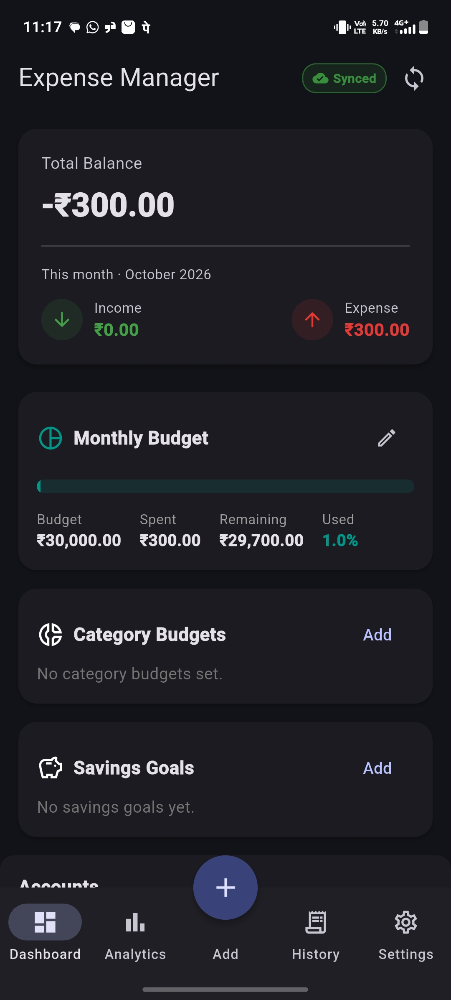
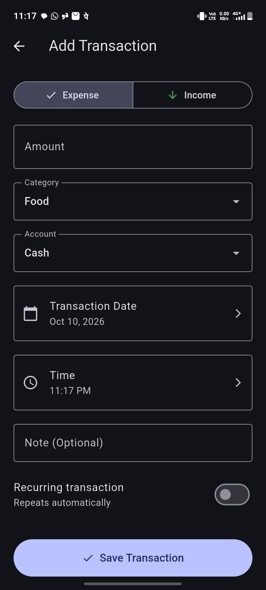
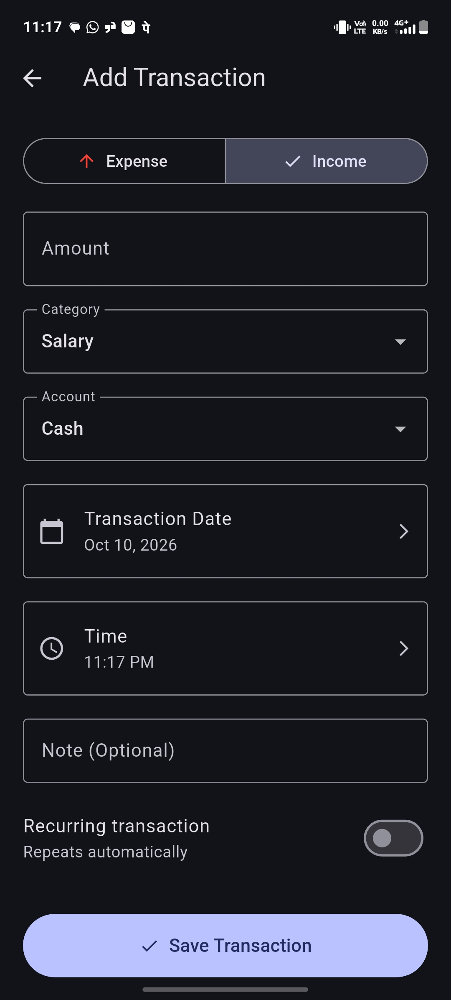
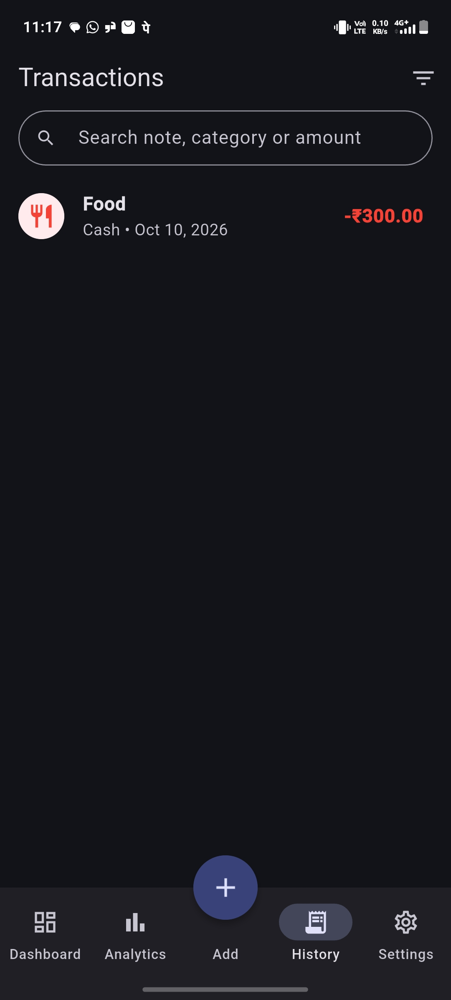
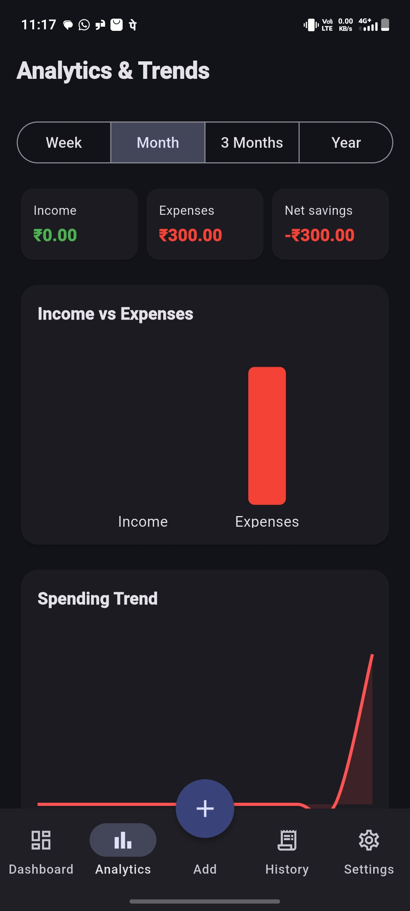
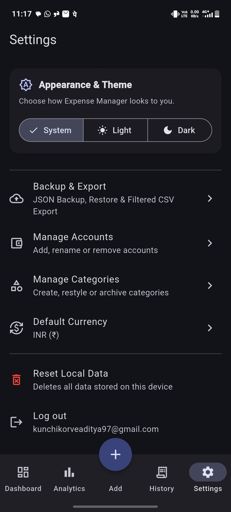
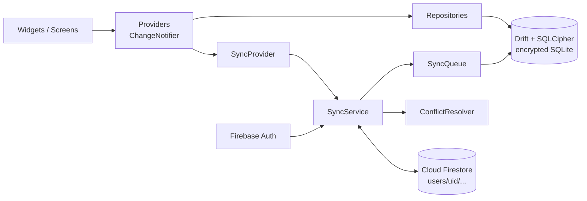

# Expense Manager

An offline-first personal expense manager built with Flutter. Everything works without internet: data is written to an **encrypted local SQLite database** first and shown immediately, then synchronised to Firebase in the background when a connection is available.

> **Demo video:** `<link>` &nbsp;|&nbsp; **Download APK:** `<link to GitHub Release>` &nbsp;|&nbsp; **CI:** `<badge or link>`

## Screenshots

| Dashboard | Add transaction | Add transaction (cont.) |
|---|---|---|
|  |  |  |

| History | Analytics | Settings |
|---|---|---|
|  |  |  |

## Features

- **Dashboard** – total balance (all-time), this month's income and expense, monthly budget with progress, category budgets, per-account balances, savings goals, recent transactions and smart insights.
- **Transactions** – income/expense with category, account, date, time, note and an optional recurring rule. Edit, swipe to delete (with undo).
- **History** – paginated list with combinable filters (type, category, account, date range, amount range) and search by note, category or amount.
- **Analytics** – Week / Month / 3 Months / Year views: income vs expenses, net savings, spending trend (line), category breakdown (donut).
- **Smart insights** – computed from local data (week-over-week change, top category, budget usage, month-over-month change, average daily spend). Nothing is hard-coded.
- **Budgets** – monthly budget with warnings at 50 / 75 / 90 / 100 % and an over-budget message, plus independent per-category budgets.
- **Accounts** – add, rename and delete accounts; per-account and combined balances.
- **Categories** – default expense/income categories plus custom categories (name, icon, colour) that can be edited or archived.
- **Recurring transactions** – daily / weekly / monthly / yearly; due items (including missed ones) are created automatically on app start.
- **Savings goals** – target, saved amount, target date, icon, add/withdraw funds.
- **Backup & restore** – full JSON export (share sheet) and import via file picker, validated before anything is changed. Filtered CSV export.
- **Theme and currency** – light / dark / system theme and INR / USD / EUR / GBP, both persisted.
- **Authentication** – email/password sign-up, login and logout. Logging out removes the local copy so the next user never sees it.
- **Sync status badge** – Synced / Syncing / N changes waiting / Offline / Sync failed.

## Architecture



The UI only ever reads from the local database. Widgets talk to providers, providers talk to repositories, and repositories talk to Drift. The sync engine runs beside this flow and never blocks it.

```
lib/
├── core/        category and goal icon maps, default categories
├── data/
│   ├── local/        Drift database, tables, DB key service
│   └── repositories/ transaction + budget repositories
├── providers/   transaction, budget, analytics, insights, category, account, goal, currency, theme, auth
├── features/    dashboard, transactions, analytics, budget, accounts, categories, goals, settings, auth, home
├── services/    backup/export service, recurring processor
├── sync/        sync_service, sync_queue, sync_remote, sync_provider, conflict_resolver
└── main.dart
```

State management is Provider / ChangeNotifier. Business logic (balances, budgets, analytics, insights) lives in providers and repositories, not in widgets.

## Database design

Local database: **Drift** over **SQLCipher** (encrypted at rest). The encryption key is a random 64-character value generated on first run and kept in the platform keystore through `flutter_secure_storage`. Databases created by older builds with a hard-coded key are re-keyed automatically on first open.

| Table | Purpose | Key columns |
|---|---|---|
| `transactions` | Income and expenses | id, userId, amount, type, categoryId, accountId, note, transactionDate, isRecurring, currency, fieldTimestamps, createdAt, updatedAt, deletedAt, syncStatus |
| `accounts` | Wallets and bank accounts | id, name, type, initialBalance, createdAt, updatedAt, deletedAt, syncStatus |
| `categories` | Default and custom categories | id, name, type, iconName, colorValue, isArchived, isCustom |
| `budgets` | Monthly (`ALL`) and per-category budgets | id, categoryId, limitAmount, month, year |
| `savings_goals` | Goals | id, name, targetAmount, currentAmount, targetDate, iconName, deletedAt, syncStatus |
| `recurring_transactions` | Recurrence rules | id, amount, type, categoryId, accountId, frequency, nextExecutionDate, isActive |

Balance = account opening balance + income − expense, calculated with SQL aggregates rather than by loading rows into memory. The history list loads 20 rows at a time.

## Local setup

Requirements: Flutter 3.44 (the version CI uses), Android SDK.

```bash
flutter pub get
dart run build_runner build --delete-conflicting-outputs   # only needed after schema changes
flutter run
```

## Cloud setup (Firebase)

1. Create a Firebase project and add an Android app with the package name from `android/app/build.gradle.kts`.
2. Download `google-services.json` into `android/app/`.
3. Enable **Authentication → Email/Password**.
4. Create a **Cloud Firestore** database.
5. Publish these security rules so each user can only reach their own data:

```
rules_version = '2';
service cloud.firestore {
  match /databases/{database}/documents {
    match /users/{uid}/{document=**} {
      allow read, write: if request.auth != null && request.auth.uid == uid;
    }
  }
}
```

Data is stored under `users/{uid}/transactions`, `users/{uid}/accounts` and `users/{uid}/goals`.

## Sync strategy

- **Local first.** Every change is written to SQLite and shown immediately, then marked `pendingCreate`, `pendingUpdate` or `pendingDelete`. Sync states are `synced`, `pendingCreate`, `pendingUpdate`, `pendingDelete`, `failed`.
- **Pull, then push.** A sync run first pulls remote changes and merges them into local rows, then pushes pending rows, so a push uploads the merged result instead of overwriting another device. Accounts are synced before transactions.
- **Delta sync.** Each collection keeps a cursor (`last synced_at` set by the server, not the device clock). Only documents changed after the cursor are fetched.
- **Soft deletes.** A delete sets `deletedAt` and syncs as a tombstone, so it cannot reappear from the cloud. Tombstones are purged locally after 30 days.
- **Failures never block the user.** If the network is unreachable the run stops and every row stays pending. Failed rows are retried; one bad record does not stop the others. Fetches use `Source.server` so being offline fails fast instead of silently reading cache.
- **Triggers.** App start, connectivity restored, app resumed, and shortly after any local change.
- **Isolation.** Data lives under the signed-in user's `uid`, enforced by the security rules above. Logging out wipes the local database and sync cursors.

## Conflict resolution

Conflicts are resolved **per field**, not per record.

Every transaction stores `field_timestamps`, the last time each field was changed on the device that changed it.

- A field changed on only one side keeps that side's value. Example: Device A edits the note and Device B edits the amount, so both changes survive.
- A field changed on both sides falls back to **Last-Write-Wins** using the per-field timestamp, then the record's `updated_at`, then a deterministic comparison, so every device converges on the same result.
- Accounts and goals have no per-field timestamps, so they use the record's `updated_at` (whole-record Last-Write-Wins).
- If the local side contributed a value, the merged record is marked pending and uploaded.

Implemented in `lib/sync/conflict_resolver.dart` (pure Dart, unit-tested in `test/conflict_field_merge_test.dart` and `test/conflict_resolver_test.dart`).

## Testing

```bash
flutter analyze
flutter test
```

Unit tests cover balance and transaction logic, budget calculations, analytics, insights, and conflict resolution (including the field-level merge). A GitHub Actions workflow (`.github/workflows/ci.yml`) runs `flutter analyze` and `flutter test` on every push and builds a release APK as a downloadable artifact.

### Manual offline test

1. Turn on airplane mode.
2. Open the app, view existing transactions, add one, edit it, delete another.
3. Close and reopen the app. All changes are still there.
4. Turn the network back on. The badge shows syncing and then synced; the transactions appear in Firestore.

## Known limitations

- **App lock (PIN / biometrics) and local notifications are not implemented.**
- Custom categories, category budgets, monthly budgets and recurring rules are stored locally but are not synced to the cloud yet. Transactions, accounts and goals are synced.
- Currency is a display setting (symbol and formatting). There is no multi-currency account support or exchange-rate conversion.
- Attachments and a receipt picker are not implemented.
- Tests are unit tests only; there are no widget or integration tests yet.
- The Transaction History list is paginated, but a 10,000-row stress test has not been run.
- Android only has been tested.

## Tech stack

Flutter · Provider · Drift · SQLCipher · flutter_secure_storage · Firebase Auth · Cloud Firestore · fl_chart · connectivity_plus · share_plus · file_picker